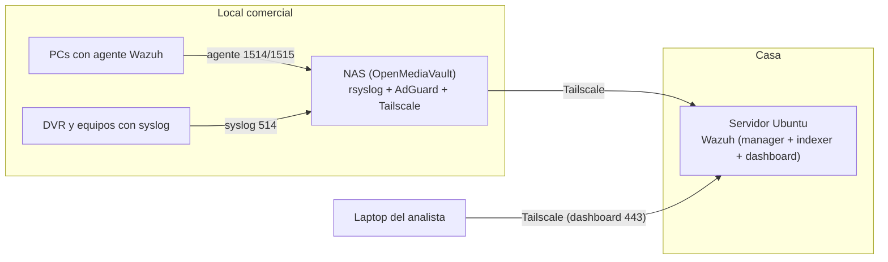

# homelab-nas-soc

Laboratorio personal de monitoreo de seguridad (Blue Team / SOC) construido con hardware reciclado y software libre. Protege y vigila la red de un negocio familiar pequeño mientras me sirve para practicar detección, respuesta a incidentes y administración de un SIEM.

## Objetivos

- Detectar consultas DNS sospechosas y dispositivos desconocidos en la red.
- Vigilar la salud de los equipos: integridad de archivos, fallos de disco y apagados inesperados.
- Entender el uso de ancho de banda de la red interna.
- Centralizar los logs en un SIEM accesible de forma remota y segura.

## Arquitectura

Solo el NAS y el servidor forman parte de la red Tailscale. Las PCs del local no necesitan instalarla: el NAS hace de puente.

## Componentes

| Componente | Función |
|---|---|
| OpenMediaVault 7 (NAS) | Almacenamiento, backups, S.M.A.R.T., colector de syslog |
| TP-Link TL-SG108E (x2) | Segmentación por VLAN y port mirroring |
| AdGuard Home | DNS filtrante y registro de consultas |
| Tailscale | Acceso remoto y enlace entre sitios (subnet router) |
| Wazuh | SIEM/XDR: FIM, logs, SCA, correlación de eventos |

## Estado del proyecto

- [x] NAS con OpenMediaVault sobre hardware reciclado
- [x] Segmentación por VLAN (DVR aislado, NAS accesible desde ambas)
- [x] Acceso remoto con Tailscale (subnet router)
- [x] Monitoreo S.M.A.R.T. con tests programados
- [x] AdGuard Home instalado
- [ ] Migrar Wazuh a un servidor Ubuntu dedicado
- [ ] Colector de syslog en el NAS (rsyslog + logrotate)
- [ ] Reglas de Wazuh para smartd y para el log de AdGuard
- [ ] Sensor de red (Suricata) con port mirroring
- [ ] ntopng para ancho de banda por host

## Documentación

Cada pieza tiene su propio documento en [`docs/`](docs/), con el problema, la decisión tomada y cómo verifiqué que funciona:

- `01-nas-omv.md`
- `02-vlans.md`
- `03-tailscale.md`
- `04-smart.md`

## Lecciones aprendidas

- Un SIEM debe vivir en una máquina estable y siempre encendida; correrlo en una laptop con WSL2 fue frágil.
- Los cambios de IP tras reinicios rompen la conexión de los agentes: conviene IPs fijas o nombres estables.
- Ruido en FIM (por ejemplo, alertas de registro de Windows): acotar rutas monitoreadas y añadir exclusiones desde el inicio.

## Nota de seguridad

Este repositorio no contiene contraseñas, claves de agentes, authkeys de Tailscale ni datos del negocio. Las configuraciones publicadas están sanitizadas.
